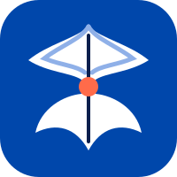

# Gimano

*"Gi mano?"* (where are you going?)

**Open-source, community-driven navigation for Malaysia.** Gimano works the way
drivers who use Waze already expect: search "Where to?", compare routes, drive
with turn-by-turn voice, and report traffic, police, accidents and hazards with
one tap. It's built entirely on open data from OpenStreetMap.

> Gimano is an independent project. It isn't affiliated with or endorsed by
> Waze or Google, and it contains no code, assets or data from them. The UX
> research behind it is a clean-room study of observable behaviour; see
> [docs/research/ux-study.md](docs/research/ux-study.md).

## Repository layout

| Path | What |
|---|---|
| [`backend/`](backend/) | .NET 10 / ASP.NET Core API, worker, and OSM importer. PostgreSQL + PostGIS, OpenSearch, RabbitMQ, Valhalla routing |
| [`android/`](android/) | Native Android app: Kotlin, Jetpack Compose, MapLibre |
| [`ios/`](ios/) | Native iOS app: Swift, SwiftUI, MapLibre |
| [`data/`](data/) | Scripts to download the Geofabrik Malaysia extract and import POIs and roads |
| [`deploy/`](deploy/) | `docker-compose.yml` for the full stack |
| [`docs/`](docs/) | [Architecture](docs/architecture.md) · [API contract](docs/api.md) · [Design tokens](docs/design-tokens.md) · [UX study](docs/research/ux-study.md) |

## Features

- Search with autocomplete over Malaysian POIs from OSM: fuel (PETRONAS, Shell, …), R&R, EV chargers, surau and mosques, malls, food, parking and more
- Route preview with 2–3 alternatives, live-traffic ETAs, avoid tolls, highways and ferries, and **car and motorcycle** profiles
- Turn-by-turn navigation with voice guidance in English and Bahasa Melayu, speedometer with speed-limit warning, and automatic reroute
- One-tap community reports (traffic, police, accident, hazard, closure, blocked lane, map issue, weather, animal), with "Still there?" confirmation by other drivers
- Live traffic computed from anonymised driver speeds, pushed in real time over SignalR
- Saved places (Home and Work), recents, planned drives, and share-your-drive

## Privacy: your places stay on your phone

*Gi mano pun, rahsia anda kekal milik anda.* Gimano never stores your personal data on its servers.
Home, work, favourites, recents and private places live only on your device. They are backed up to
**your own** Google Drive, iCloud or a file, optionally end-to-end encrypted with a passphrase only you
know. See the [privacy promise](docs/privacy-promise.md) and [how it works](docs/privacy-and-backup.md).

## Quick start

```bash
# 1. Backend stack (Postgres/PostGIS, OpenSearch, RabbitMQ, Valhalla, API, worker)
./data/download-osm.sh
docker compose -f deploy/docker-compose.yml up -d
./data/import.sh

# 2. Android
cd android && ./gradlew installDebug -Pgimano.apiBaseUrl=http://<your-ip>:5080/api/v1/

# 3. iOS
open ios/Gimano.xcodeproj
```

See each folder's README for details.

## Data & licences

- Code: [MIT](LICENSE)
- Map and POI data: © [OpenStreetMap contributors](https://www.openstreetmap.org/copyright), available under the [ODbL](https://opendatacommons.org/licenses/odbl/). Both apps show this attribution on the map.
- Basemap tiles in development: [OpenFreeMap](https://openfreemap.org)

## Contributing

Issues and PRs are welcome. Please don't contribute data copied from proprietary
map products (Google Maps, Waze, etc.); fix the map upstream in OpenStreetMap
instead.
